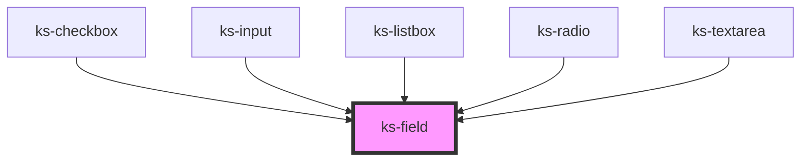

# ks-field

<!-- Auto Generated Below -->

## Overview

ks-field
─────────────────────────────────────────────────────────────
Presentation-only layout wrapper shared by all inline input
components (input, textarea, checkbox, radio, switch, slider…).
Ported from Angular `KsFieldComponent`.

Slots:
  Default slot     → the input control
  [ksFieldActions] → optional trailing actions (e.g. clear button, character count)
                       mapped to native `slot="actions"` internally.

Usage:
  <ks-field label="Email" hint="We'll never share your email.">
    <input ks-input />
  </ks-field>

## Properties

| Property   | Attribute  | Description                                                           | Type      | Default |
| ---------- | ---------- | --------------------------------------------------------------------- | --------- | ------- |
| `disabled` | `disabled` | Disabled state — dims the label                                       | `boolean` | `false` |
| `error`    | `error`    | Error message — takes priority over hint; triggers error styling      | `string`  | `''`    |
| `fieldId`  | `field-id` | Optional ID forwarded to the label's `for` attribute                  | `string`  | `''`    |
| `hint`     | `hint`     | Helper text rendered below the input — hidden when error is set       | `string`  | `''`    |
| `label`    | `label`    | Label rendered above the input area                                   | `string`  | `''`    |
| `required` | `required` | Marks the field as required — appends a visual indicator to the label | `boolean` | `false` |

## Slots

| Slot        | Description      |
| ----------- | ---------------- |
|             | The default slot |
| `"actions"` |                  |

## Dependencies

### Used by

 - [ks-checkbox](../../Inputs/checkbox)
 - [ks-input](../../Inputs/input)
 - [ks-listbox](../../Dropdowns/listbox)
 - [ks-radio](../../Inputs/radio)
 - [ks-textarea](../../Inputs/textarea)

### Graph

----------------------------------------------

*Built with [StencilJS](https://stenciljs.com/)*
