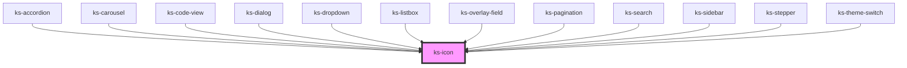

# ks-icon

<!-- Auto Generated Below -->

## Overview

Ported from Angular `KsIconComponent` (`ks-icon`).
Class name (minus the Angular 'Component' suffix, per project convention): KsIcon.

## Properties

| Property            | Attribute         | Description                                                     | Type                                                                                                                                                                                                                             | Default     |
| ------------------- | ----------------- | --------------------------------------------------------------- | -------------------------------------------------------------------------------------------------------------------------------------------------------------------------------------------------------------------------------- | ----------- |
| `containerClass`    | `container-class` | Extra classes applied to the outer container              | `string`                                                                                                                                                                                                                         | `''`        |
| `icon` _(required)_ | `icon`            | Icon name — required, resolved via GetIconPath() (ks-ui.types). | `"calender" \| "check" \| "chervon-down" \| "circle-check" \| "circle-empty" \| "clock" \| "close" \| "copy" \| "moon" \| "search" \| "square-check" \| "square-empty" \| "star-empty" \| "sun" \| "system" \| "triangle-empty"` | `undefined` |
| `iconClass`         | `icon-class`      | Extra classes applied to the inner <svg>                        | `string`                                                                                                                                                                                                                         | `''`        |

## Events

| Event       | Description                       | Type                |
| ----------- | --------------------------------- | ------------------- |
| `iconClick` | Emitted when the icon is clicked. | `CustomEvent<void>` |

## Dependencies

### Used by

 - [ks-accordion](../../Navigation/accordion)
 - [ks-carousel](../../Navigation/carousel)
 - [ks-code-view](../../Layout/code-view)
 - [ks-dialog](../../Layout/dialog)
 - [ks-dropdown](../../Dropdowns/dropdown)
 - [ks-listbox](../../Dropdowns/listbox)
 - [ks-overlay-field](../ks-overlay-field)
 - [ks-pagination](../../Navigation/pagination)
 - [ks-search](../ks-search)
 - [ks-sidebar](../../Layout/sidebar)
 - [ks-stepper](../../Navigation/stepper)
 - [ks-theme-switch](../../Inputs/theme-switch)

### Graph

----------------------------------------------

*Built with [StencilJS](https://stenciljs.com/)*
