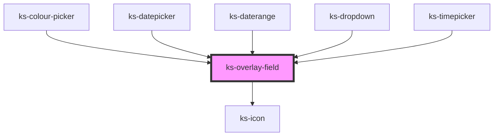

# ks-overlay-field

<!-- Auto Generated Below -->

## Overview

ks-overlay-field
─────────────────────────────────────────────────────────────
Presentation-only wrapper shared by datepicker, daterange and
timepicker. Ported from Angular `KsOverlayFieldComponent`.

Usage:
  <ks-overlay-field label="Date" display-value="2024-01-01" icon="calender">
    <!-- panel content projected here (default slot) -->
    <my-calendar-panel />
  </ks-overlay-field>

## Properties

| Property       | Attribute       | Description                                                      | Type                                                                                                                                                                                                                             | Default      |
| -------------- | --------------- | ---------------------------------------------------------------- | -------------------------------------------------------------------------------------------------------------------------------------------------------------------------------------------------------------------------------- | ------------ |
| `disabled`     | `disabled`      | Whether the trigger is disabled                                  | `boolean`                                                                                                                                                                                                                        | `false`      |
| `displayValue` | `display-value` | Formatted display value shown inside the trigger                 | `string`                                                                                                                                                                                                                         | `''`         |
| `icon`         | `icon`          | Icon name (e.g. 'calender', 'clock')                             | `"calender" \| "check" \| "chervon-down" \| "circle-check" \| "circle-empty" \| "clock" \| "close" \| "copy" \| "moon" \| "search" \| "square-check" \| "square-empty" \| "star-empty" \| "sun" \| "system" \| "triangle-empty"` | `'calender'` |
| `isOpen`       | `is-open`       | Two-way open state — mutable prop (Angular `model<boolean>`)     | `boolean`                                                                                                                                                                                                                        | `false`      |
| `label`        | `label`         | Optional field label rendered above the trigger                  | `string`                                                                                                                                                                                                                         | `''`         |
| `overlayWidth` | `overlay-width` | 'trigger' matches trigger width, 'auto' leaves panel width unset | `"auto" \| "trigger"`                                                                                                                                                                                                            | `'auto'`     |
| `panelClass`   | `panel-class`   | Extra CSS classes forwarded to the panel wrapper                 | `string`                                                                                                                                                                                                                         | `''`         |
| `placeholder`  | `placeholder`   | Placeholder shown when displayValue is empty                     | `string`                                                                                                                                                                                                                         | `'Select…'`  |
| `triggerClass` | `trigger-class` | Extra CSS classes forwarded to the trigger button                | `string`                                                                                                                                                                                                                         | `''`         |

## Events

| Event          | Description                                                            | Type                   |
| -------------- | ---------------------------------------------------------------------- | ---------------------- |
| `closed`       | Fires after the panel closes                                           | `CustomEvent<void>`    |
| `isOpenChange` | Fires whenever `isOpen` changes (two-way binding support for wrappers) | `CustomEvent<boolean>` |
| `opened`       | Fires after the panel opens                                            | `CustomEvent<void>`    |

## Methods

### `close() => Promise<void>`

#### Returns

Type: `Promise<void>`

### `open() => Promise<void>`

Public handles equivalent to Angular's
`viewChild.required(KsOverlayFieldComponent)` + `.open()/.close()/.toggle()`
(used by colour-picker, datepicker, daterange, timepicker).

#### Returns

Type: `Promise<void>`

### `toggle() => Promise<void>`

#### Returns

Type: `Promise<void>`

## Slots

| Slot | Description      |
| ---- | ---------------- |
|      | The default slot |

## Dependencies

### Used by

 - [ks-colour-picker](../../Inputs/colour-picker)
 - [ks-datepicker](../../Calendars/datepicker)
 - [ks-daterange](../../Calendars/daterange)
 - [ks-dropdown](../../Dropdowns/dropdown)
 - [ks-timepicker](../../Calendars/timepicker)

### Depends on

- [ks-icon](../ks-icon)

### Graph

----------------------------------------------

*Built with [StencilJS](https://stenciljs.com/)*
